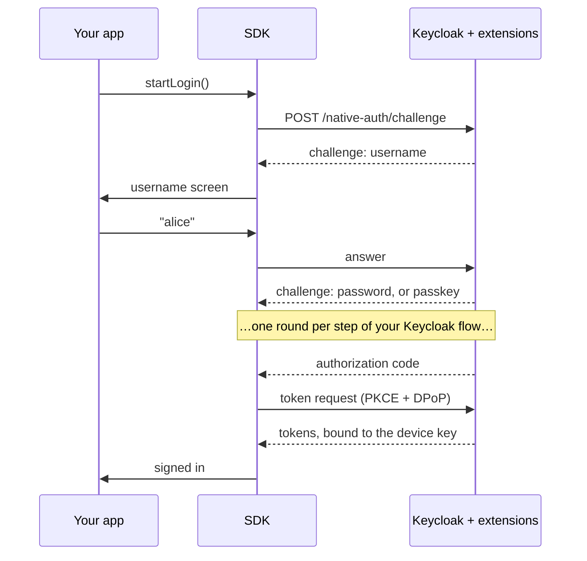

# Native login for Keycloak

[](https://github.com/p2-inc/native-apps/actions/workflows/ci.yml)


[](#-license)

**Sign users in to Keycloak with your app's own screens, not a browser.**

Your Keycloak keeps running the login flow: passwords, passkeys, one-time codes, push approvals, required actions, brute-force protection. These extensions hand each step to your app as JSON, and the SDKs turn it into native screens for iOS, Android, React Native and Flutter.

<!-- Demo GIF goes here: docs/media/native-login.gif (username → password → TOTP on the default screens). -->

## ✨ Why

- **No browser sheet.** No "wants to use … to sign in" prompt and no web page inside your app. The login looks and feels like the rest of it.
- **Keycloak stays in charge.** Change the flow, add a second factor or require an action in the admin console, and every app follows without a release.
- **Better than the password grant.** You get MFA, passkeys, required actions and brute-force rules, which the password grant skips, and tokens bound to the device with DPoP.

Registration, password reset, TOTP enrollment and social or enterprise identity providers stay on Keycloak's own pages. When a login reaches a step the app can't show natively, the SDK finishes that login in the system browser and the user comes back signed in.

## 🧭 How it works



The protocol follows the IETF draft [OAuth 2.0 for First-Party Applications](https://datatracker.ietf.org/doc/draft-ietf-oauth-first-party-apps/). Details: [protocol and flows](docs/protocol-and-flows.md).

## 🧩 What runs natively

| | |
|---|---|
| 🔑 Passwords | with the platform password manager: AutoFill on iOS, Credential Manager on Android |
| 🪪 Passkeys | sign in, enroll after a password login, or register one later in the app |
| 🔢 One-time codes | TOTP, email and SMS codes, recovery codes |
| 📲 Push approval | number matching, through APNs or Firebase Cloud Messaging |
| ⬆️ Step-up | ask for a stronger factor before a sensitive action |
| 📋 Required actions | update password, verify email, accept terms, register a passkey or push device |

All four SDKs cover all of it, with default screens you can use as they are or replace one at a time.

## 🚀 Try it in 5 minutes

You need Docker, Java 21 and Maven. Start Keycloak with the demo realm:

```bash
git clone https://github.com/p2-inc/native-apps && cd native-apps/keycloak-native-auth
mvn -DskipTests -DskipITs package
cd demo && docker compose up --wait     # Keycloak on :8080, mailpit on :8025
```

Then run a demo app and sign in as **`alice`** / **`alice-password`**. The TOTP code comes from `./scripts/walkthrough.sh` or any authenticator app set up with the key `alice-totp-secret-20261014`.

| | Run the demo |
|---|---|
| 📱 iOS | Start compose with `KC_PORT=8089 docker compose up --wait`, open `ios/KeycloakNativeDemo/KeycloakNativeDemo.xcodeproj` and run on a simulator. [More](ios/KeycloakNativeDemo/README.md) |
| 🤖 Android | `cd android && ./gradlew :demo:installDebug` with an emulator running. [More](android/demo/README.md) |
| ⚛️ React Native | `cd react-native/keycloak-native-react-native && yarn && yarn example ios` (or `android`). [More](react-native/keycloak-native-react-native/README.md) |
| 🐦 Flutter | `cd flutter/keycloak_native_flutter/example && flutter run`. [More](flutter/keycloak_native_flutter/README.md) |

The demo realm has a user for every scenario: `bob` gets an email code (read it in mailpit), `hank` has to accept terms, `carol` has to update her password. [All demo users](docs/flow-examples.md).

## 🛠️ Add it to your Keycloak

1. Download `keycloak-native-auth-providers-<version>.zip` from the [latest release](https://github.com/p2-inc/native-apps/releases) and put the jars in Keycloak's `providers/` directory. Install all of them; they depend on each other.
2. Create an authentication flow named `native` from the native steps (`native-username`, `native-password`, `native-totp`, `native-passkey`, …). Don't bind it as the browser flow: the native endpoint finds it by name, and a client or realm can pick another with the `native-auth.flow-alias` attribute. The [demo realm](keycloak-native-auth/demo/realm-export/demo-realm.json) has complete examples.
3. Create a public OpenID Connect client with PKCE S256 and the attribute `native-auth.enabled` = `true`, and add a redirect URI for the browser fallback.

Full setup, including passkey domains and push: [server guide](keycloak-native-auth/README.md). On [Phase Two](https://phasetwo.io) hosted Keycloak, [ask us](https://phasetwo.io/contact) to turn it on.

## 📱 iOS

Swift package, iOS 17+. Add `https://github.com/p2-inc/native-apps` in Xcode and link `KeycloakNativeCore` and `KeycloakNativeUI`.

```swift
let kc = KeycloakNative.configure(
  issuer: URL(string: "https://idp.example.com/realms/demo")!,
  clientId: "my-app"
)

// In your SwiftUI view, with `flow = kc.authentication().startLogin(LoginParameters(scope: "openid profile"))`:
NativeLoginView(kc: kc, flow: flow) { result in
  if case .authorized(let credentials) = result {
    Task { try await kc.credentialsManager().store(credentials) }
  }
}
```

📖 [iOS guide](docs/ios-integration.md) · [demo app](ios/KeycloakNativeDemo/README.md)

## 🤖 Android

Kotlin and Jetpack Compose, Android 9+ (API 28), from Maven Central.

```kotlin
implementation("io.phasetwo.keycloak.nativeauth:keycloak-native-android:0.3.0")
implementation("io.phasetwo.keycloak.nativeauth:keycloak-native-ui:0.3.0")
```

```kotlin
val kc = KeycloakNative.configure(URI("https://idp.example.com/realms/demo"), "my-app", options)

// In a composable, with `flow = kc.authentication().startLogin(LoginParameters(scope = "openid profile"))`:
NativeLoginScreen(kc, flow, onResult = { result ->
  if (result is NativeLoginResult.Authorized) scope.launch { kc.credentialsManager().store(result.credentials) }
})
```

📖 [Android guide](docs/android-integration.md) (it shows the `options` for Keystore storage, passkeys and the browser fallback) · [demo app](android/demo/README.md)

## ⚛️ React Native

A TurboModule for React Native 0.84+ with the New Architecture, plus an Expo config plugin.

```bash
npm install @phasetwo/keycloak-native-react-native
```

```tsx
const kc = KeycloakNative.configure({ issuer: 'https://idp.example.com/realms/demo', clientId: 'my-app' });

<NativeLoginScreen
  kc={kc}
  flow={flow}  // from kc.authentication.startLogin({ scope: 'openid profile' })
  onResult={async (result) => {
    if (result.kind === 'authorized') await kc.credentialsManager.store(result.credentials);
  }}
/>
```

📖 [React Native guide](docs/react-native-integration.md)

## 🐦 Flutter

A plugin for Flutter 3.35+ on iOS and Android.

```bash
flutter pub add keycloak_native_flutter
```

```dart
final kc = await KeycloakNative.configure(
  issuer: Uri.parse('https://idp.example.com/realms/demo'),
  clientId: 'my-app',
);

NativeLoginView(
  kc: kc,
  flow: flow, // from kc.authentication.startLogin(const LoginParameters(scope: 'openid profile'))
  onResult: (result) async {
    if (result is NativeLoginAuthorized) await kc.credentialsManager.store(result.credentials);
  },
);
```

📖 [Flutter guide](docs/flutter-integration.md)

## 🔐 Security

- **PKCE** on every login, and **DPoP** binds the code, access token and refresh token to a key in the Secure Enclave or Android Keystore. We recommend turning DPoP on for every app ([why, and what it asks of your APIs](docs/security.md#recommended-dpop-for-every-client-refresh-tokens-stay-native)).
- Tokens live in the Keychain or Keystore. In React Native and Flutter, the refresh token never reaches JavaScript or Dart.
- The flow, MFA, brute-force rules and required actions are enforced by Keycloak, not by the app.

Read the [security model](docs/security.md). To report a vulnerability, see [SECURITY.md](SECURITY.md).

## 📊 Status

Pre-1.0: any release can change the protocol or the API, so pin exact versions. Every SDK is tested in CI against recorded exchanges with Keycloak 26.4, 26.6 and 26.8, and the demo apps run on simulators and emulators. Next up is verification on real devices with passkeys and real push delivery. See the [roadmap](ROADMAP.md).

## 📚 Learn more

- [Documentation](docs/README.md): setup, protocol, flow examples, troubleshooting
- [Launch post](https://phasetwo.io/blog/native-login-keycloak-ios-android/) and [docs on phasetwo.io](https://phasetwo.io/docs/securing-applications/native-apps/)
- [Contributing](CONTRIBUTING.md), including how releases are cut
- Questions and bugs: [issues](https://github.com/p2-inc/native-apps/issues). Hosted Keycloak and support: [Phase Two](https://phasetwo.io/contact)

## 📄 License

The SDKs, the React Native and Flutter wrappers and the demo setup are [Apache 2.0](LICENSE). The Keycloak extensions are under the [Elastic License 2.0](keycloak-native-auth/COPYING), like Phase Two's other extensions: free to use and self-host, but not to offer as a hosted service.

<details>
<summary>Which license covers which files</summary>

| Path | License |
|---|---|
| `Package.swift`, `ios/`, `android/`, `flutter/`, `react-native/`, `spec/`, `docs/` | Apache-2.0 ([LICENSE](LICENSE), [NOTICE](NOTICE)) |
| `keycloak-native-auth/demo/` except `src/`: compose files, realm export, resource server, scripts and recorded transcripts | Apache-2.0 ([LICENSE](keycloak-native-auth/demo/LICENSE)) |
| `keycloak-native-auth/push-mfa-extension-java21/`: ba-itsys' push MFA extension, rebuilt for Java 21 | Apache-2.0 ([LICENSE](keycloak-native-auth/push-mfa-extension-java21/LICENSE), [NOTICE](keycloak-native-auth/push-mfa-extension-java21/NOTICE)) |
| Everything else in `keycloak-native-auth/`, including the integration tests in `demo/src/` | ELv2 ([COPYING](keycloak-native-auth/COPYING)) |

</details>

Copyright 2026 Phase Two, Inc.
