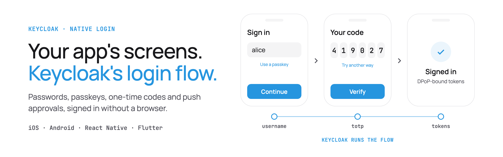
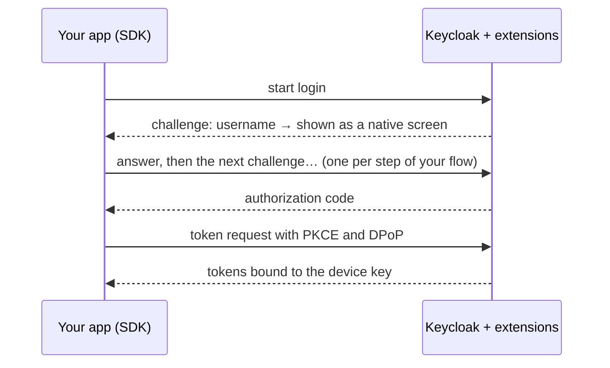

# Native login for Keycloak

[](https://github.com/p2-inc/native-apps/actions/workflows/ci.yml)


[](#-license)

Sign users in to Keycloak with your app's own screens. Keycloak keeps running the login flow, with its passwords, passkeys, one-time codes, push approvals, required actions and brute-force protection. These extensions hand each step to your app as JSON, and the SDKs for iOS, Android, React Native and Flutter turn it into native screens.

<picture>
  <source media="(prefers-color-scheme: dark)" srcset="docs/media/banner-dark.png">
  
</picture>

<!-- Demo GIF goes here: docs/media/native-login.gif (username → password → TOTP on the default screens). -->

## ✨ Why

- **No browser sheet.** Browser-based login (AppAuth) shows a "wants to use … to sign in" prompt and Keycloak's web pages. Here every step is a screen in your app.
- **The flow lives in Keycloak.** Change the flow, add a second factor or require an action in the admin console, and every app follows without a release.
- **Unlike the password grant,** it supports MFA, passkeys, required actions and brute-force rules, and tokens can be bound to the device with DPoP.

Some things stay on Keycloak's own pages: registration, password reset, TOTP enrollment, and social or enterprise identity providers. When a login reaches one of those, the SDK finishes it in the system browser and the user comes back signed in.

## 🧭 How it works



The protocol follows the IETF draft [OAuth 2.0 for First-Party Applications](https://datatracker.ietf.org/doc/draft-ietf-oauth-first-party-apps/). Details: [protocol and flows](docs/protocol-and-flows.md).

## 🧩 What runs natively

| | |
|---|---|
| 🔑 Passwords | with the platform password manager: AutoFill on iOS, Credential Manager on Android |
| 🪪 Passkeys | sign in, enroll after a password login, or register one later in the app |
| 🔢 One-time codes | TOTP, email and SMS codes, recovery codes |
| 📲 Push approval | number matching, through APNs or Firebase Cloud Messaging |
| ⬆️ Step-up | ask for a stronger factor before a sensitive action |
| 📋 Required actions | update password, verify email, accept terms, register a passkey or push device |

Every SDK has default screens for all of these. Use them as they are, or replace them one at a time.

## 🚀 Try it locally

You need Docker, Java 21 and Maven, plus the toolchain for the platform you pick (Xcode, Android Studio, Node with Yarn, or Flutter). Start Keycloak with the demo realm:

```bash
git clone https://github.com/p2-inc/native-apps && cd native-apps/keycloak-native-auth
mvn -DskipTests -DskipITs package
cd demo && docker compose up --wait    # Keycloak on :8080, mailpit on :8025
```

The iOS demo app expects Keycloak on port 8089, so for iOS start it with `KC_PORT=8089 docker compose up --wait` instead.

Then run a demo app from the repository root and sign in as `alice` / `alice-password`. For the second factor, `./scripts/walkthrough.sh` in the demo directory prints the current TOTP code (it needs `curl`, `jq` and `openssl`), or set up any authenticator app with the key `alice-totp-secret-20261014`.

| | From the repository root |
|---|---|
| 📱 iOS | Open `ios/KeycloakNativeDemo/KeycloakNativeDemo.xcodeproj` and run it on a simulator ([details](ios/KeycloakNativeDemo/README.md)) |
| 🤖 Android | `cd android && ./gradlew :demo:installDebug` with an emulator running ([details](android/demo/README.md)) |
| ⚛️ React Native | `cd react-native/keycloak-native-react-native && yarn && yarn example ios` (or `android`) |
| 🐦 Flutter | `cd flutter/keycloak_native_flutter/example && flutter run` |

Other demo users show other parts of the flow: `bob` gets an email code (read it in mailpit), `hank` has to accept terms, and `carol` has to update her password. [All of them](docs/flow-examples.md).

## 🛠️ Add it to your Keycloak

Keycloak 26.4 or later.

1. Download `keycloak-native-auth-providers-<version>.zip` from the [latest release](https://github.com/p2-inc/native-apps/releases) and put all its jars in Keycloak's `providers/` directory; they depend on each other.
2. Create an authentication flow named `native` from the native steps (`native-username`, `native-password`, `native-totp`, `native-passkey` and so on). Don't bind it as the browser flow: the native endpoint finds it by name, and a client or realm can choose another with the `native-auth.flow-alias` attribute. The [demo realm](keycloak-native-auth/demo/realm-export/demo-realm.json) is a working example to import or copy from.
3. Create a public OpenID Connect client with PKCE S256 and the attribute `native-auth.enabled` set to `true`, and register a redirect URI such as `myapp://auth/callback` for logins that finish in the browser.

The [server guide](keycloak-native-auth/README.md) covers every setting, passkey domains and push. On [Phase Two](https://phasetwo.io) hosted Keycloak, [contact us](https://phasetwo.io/contact) and we'll install the extensions on your cluster.

## 📱 iOS

A Swift package for iOS 17+. In Xcode, add `https://github.com/p2-inc/native-apps` and link `KeycloakNativeCore` and `KeycloakNativeUI`.

```swift
import KeycloakNativeCore
import KeycloakNativeUI

let kc = KeycloakNative.configure(
  issuer: URL(string: "https://idp.example.com/realms/demo")!,
  clientId: "my-app"
)
let flow = kc.authentication().startLogin(LoginParameters(scope: "openid profile"))

// In a SwiftUI view:
NativeLoginView(kc: kc, flow: flow) { result in
  if case .authorized(let credentials) = result {
    Task { try await kc.credentialsManager().store(credentials) }
  }
}
```

📖 [iOS guide](docs/ios-integration.md), including passkeys (Associated Domains) and push.

## 🤖 Android

Kotlin and Jetpack Compose for Android 9+ (API 28), from Maven Central.

```kotlin
implementation("io.phasetwo.keycloak.nativeauth:keycloak-native-android:0.3.0")
implementation("io.phasetwo.keycloak.nativeauth:keycloak-native-ui:0.3.0")
```

```kotlin
val kc = KeycloakNative.configure(
  URI("https://idp.example.com/realms/demo"),
  "my-app",
  KeycloakNative.Options(
    hardwareKeys = KeystoreDPoPKeys(context),                        // DPoP key in the Android Keystore
    secureStore = KeystoreSecureStore(context, namespace = "my-app"), // tokens sealed by the Keystore
  ),
)
val flow = kc.authentication().startLogin(LoginParameters(scope = "openid profile"))

// In a composable:
NativeLoginScreen(kc, flow, onResult = { result ->
  if (result is NativeLoginResult.Authorized) scope.launch { kc.credentialsManager().store(result.credentials) }
})
```

📖 [Android guide](docs/android-integration.md), including the activity setup for passkeys, saved passwords and the browser fallback.

## ⚛️ React Native

A TurboModule for React Native 0.84+ (New Architecture), with an Expo config plugin.

```bash
npm install @phasetwo/keycloak-native-react-native
```

```tsx
import { KeycloakNative, NativeLoginScreen } from '@phasetwo/keycloak-native-react-native';

const kc = KeycloakNative.configure({ issuer: 'https://idp.example.com/realms/demo', clientId: 'my-app' });
const flow = await kc.authentication.startLogin({ scope: 'openid profile' });

<NativeLoginScreen
  kc={kc}
  flow={flow}
  onResult={async (result) => {
    if (result.kind === 'authorized') await kc.credentialsManager.store(result.credentials);
  }}
/>
```

📖 [React Native guide](docs/react-native-integration.md), including the Android activity and Expo setup.

## 🐦 Flutter

A plugin for Flutter 3.35+ on iOS and Android.

```bash
flutter pub add keycloak_native_flutter
```

```dart
import 'package:keycloak_native_flutter/keycloak_native_flutter.dart';

final kc = await KeycloakNative.configure(
  issuer: Uri.parse('https://idp.example.com/realms/demo'),
  clientId: 'my-app',
);
final flow = await kc.authentication.startLogin(const LoginParameters(scope: 'openid profile'));

NativeLoginView(
  kc: kc,
  flow: flow,
  onResult: (result) async {
    if (result is NativeLoginAuthorized) await kc.credentialsManager.store(result.credentials);
  },
);
```

📖 [Flutter guide](docs/flutter-integration.md), including the Android activity setup.

## 🔐 Security

- **PKCE** on every login. **DPoP** binds the code, access token and refresh token to a key in the Secure Enclave or Android Keystore. We recommend DPoP for every app; your APIs then need to accept `Authorization: DPoP` and check the proof ([details](docs/security.md#recommended-dpop-for-every-client-refresh-tokens-stay-native)).
- Tokens are stored in the Keychain or Keystore. In React Native and Flutter, the refresh token never reaches JavaScript or Dart.
- Keycloak enforces the flow, MFA, brute-force rules and required actions, not the app.

Read the [security model](docs/security.md). To report a vulnerability, see [SECURITY.md](SECURITY.md).

## 📊 Status

Pre-1.0: any release can change the protocol or the API, so pin exact versions. The Maven Central, npm and pub.dev packages above start with 0.3.0.

The Keycloak extensions are integration-tested against Keycloak 26.4, 26.6 and 26.8. Each SDK is tested in CI by replaying recorded server exchanges, and the demo apps run on simulators and emulators. Passkeys and push delivery on real devices are being verified now. See the [roadmap](ROADMAP.md).

## 📚 Learn more

- [Documentation](docs/README.md): setup, protocol, flow examples, troubleshooting, and the repository layout
- [Native apps on phasetwo.io](https://phasetwo.io/docs/securing-applications/native-apps/) and the [launch post](https://phasetwo.io/blog/native-login-keycloak-ios-android/)
- [Contributing](CONTRIBUTING.md) and [issues](https://github.com/p2-inc/native-apps/issues)

## 📄 License

The SDKs, the React Native and Flutter wrappers and the demo setup are [Apache 2.0](LICENSE). The Keycloak extensions are under the [Elastic License 2.0](keycloak-native-auth/COPYING), like Phase Two's other extensions: free to use and self-host, but not to offer as a hosted service.

<details>
<summary>Which license covers which files</summary>

| Path | License |
|---|---|
| `Package.swift`, `ios/`, `android/`, `flutter/`, `react-native/`, `spec/`, `docs/` | Apache-2.0 ([LICENSE](LICENSE), [NOTICE](NOTICE)) |
| `keycloak-native-auth/demo/` except `src/`: compose files, realm export, resource server, scripts and recorded transcripts | Apache-2.0 ([LICENSE](keycloak-native-auth/demo/LICENSE)) |
| `keycloak-native-auth/push-mfa-extension-java21/`: ba-itsys' push MFA extension, rebuilt for Java 21 | Apache-2.0 ([LICENSE](keycloak-native-auth/push-mfa-extension-java21/LICENSE), [NOTICE](keycloak-native-auth/push-mfa-extension-java21/NOTICE)) |
| Everything else in `keycloak-native-auth/`, including the integration tests in `demo/src/` | ELv2 ([COPYING](keycloak-native-auth/COPYING)) |

</details>

Copyright 2026 Phase Two, Inc.
