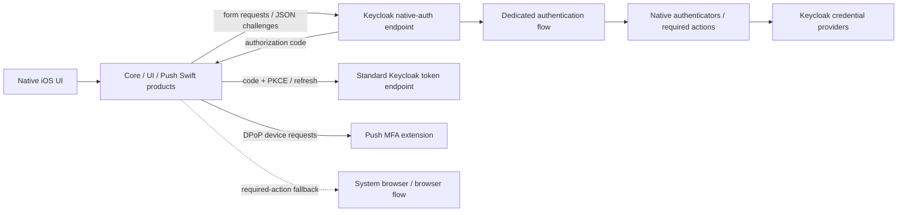

# Native authentication for Keycloak

This repository lets an application render Keycloak authentication challenges as native screens. The server runs a dedicated Keycloak flow, the SDK exchanges its structured challenges and authorization code, and the application owns UI and navigation. Supported native paths need neither a browser nor a webview. Some account actions require a separate login in the system browser.

**The iOS and Android SDKs and their demo apps are implemented** (see [`android/`](../android/), [the Android demo README](../android/demo/README.md) and [the Android plan](../spec/17-android-sdk-plan.md)). The HTTP contract is platform-neutral; each SDK has its own integration guide.

## Reading guide

| Guide | Use it for |
| --- | --- |
| [Protocol and flows](protocol-and-flows.md) | HTTP contract, server configuration, authenticator reference, flow composition |
| [Flow examples](flow-examples.md) | Ordered executions, native screens, requests, responses, and terminal outcomes |
| [iOS integration](ios-integration.md) | Install the package, drive challenges, store and refresh credentials |
| [Android integration](android-integration.md) | Add the Gradle modules, drive challenges, store and refresh credentials, push over FCM |
| [Sample application](sample-app.md) | Run and understand the demo, including passkey and push setup |
| [Development and troubleshooting](development-and-troubleshooting.md) | Builds, tests, diagnostics, compatibility and verification record |
| [Security](security.md) | Trust boundaries, implemented protections, deployment responsibilities and gaps |

## Architecture and support



Implemented: username/email identification, password, existing TOTP credentials, passwordless WebAuthn passkeys (identified and discoverable), passkey registration during or after login, email/SMS codes, existing recovery codes, push enrollment and approvals, level-based step-up and reauthentication. Native required actions serve password update, email verification by code, terms acceptance, passkey registration and push enrollment. See [flow prerequisites](flow-examples.md).

Not implemented natively: new-user registration, forgotten-password recovery, TOTP enrollment, recovery-code generation, social/identity-provider login, arbitrary Keycloak HTML authenticators, device/app attestation, or `select` challenges. Local biometrics are used by platform passkey UI where applicable; there is no independent biometric server-login API. Browser fallback currently originates from unsupported **required actions**, not arbitrary unsupported executions.

The custom challenge endpoint is inspired by the FiPA draft identified in metadata. It is not Keycloak's normal OIDC authorization endpoint. Completion creates a Keycloak user/client session and a normal authorization code; exchange, refresh, revocation and logout use Keycloak's OIDC endpoints. Native sessions do not establish browser SSO cookies. No standards-conformance claim is implied.

## Practical quick start

Prerequisites: Java 21 target, Maven, Docker with Compose, `curl`, `jq`, `openssl`; for the app, macOS, Xcode with Swift 6 and an installed iOS 17+ simulator. The server builds against **Keycloak 26.8.1** and push MFA **2.3.7** in the [parent POM](../keycloak-native-auth/pom.xml); the same JARs are tested on stock Keycloak 26.4, 26.6 and 26.8 ([Keycloak versions](../keycloak-native-auth/README.md#keycloak-versions)). The [Swift package](../Package.swift) (root manifest, sources under `ios/KeycloakNative/`) declares iOS 17/macOS 14 minimums, Swift 6, and no library package dependencies. Releases older than 26.4 are not compatibility targets.

From the repository root:

```bash
cd keycloak-native-auth
mvn -DskipTests -DskipITs package
cd demo
KC_PORT=8089 docker compose up --wait
KC_BASE=http://localhost:8089 ./scripts/walkthrough.sh
```

Packaging assembles all deployable JARs in `demo/target/providers/`; Compose mounts them into `/opt/keycloak/providers` and imports [demo-realm.json](../keycloak-native-auth/demo/realm-export/demo-realm.json). It also starts Postgres, mailpit (`http://localhost:8025`) and the step-up demo API (`http://localhost:8091`). Admin console: `http://localhost:8089/admin`, development credentials `admin` / `admin`.

The import already supplies realm `demo`, public client `demo-native`, `native-auth.enabled=true`, standard flow enabled, PKCE S256, and realm attribute `native-auth.flow-alias=native`. Do not bind this flow as the browser flow: the custom endpoint selects it by attribute. Existing persisted realms are not overwritten by startup import; use an isolated fresh stack or deliberately update the realm. [Flow layouts](flow-examples.md) explain the supplied clients and executions.

The walkthrough logs in `alice` through username → password → TOTP → code → tokens, computes the current seeded TOTP, and checks its responses. The seeded credentials are development fixtures only. To avoid consuming MFA or required-action state initially, the app can also log in `bob` / `bob-password` through username and password alone.

```bash
cd ../../ios/KeycloakNativeDemo
xcodebuild -list -project KeycloakNativeDemo.xcodeproj
```

Open that project in Xcode, choose the **KeycloakNativeDemo application scheme**, select an available simulator and Run. [App/Config.plist](../ios/KeycloakNativeDemo/App/Config.plist) already points to port **8089**, unlike Compose's default **8080**. Choose S3, enter `alice` / `alice-password` and the TOTP printed by the walkthrough (recompute if its 30-second window passed). Home shows token type, username and expiry; Diagnostics shows redacted challenge and token exchanges. No passkey is preseeded; password/TOTP needs no Apple team or APNs setup.

Follow [sample setup](sample-app.md) for passkeys, push and browser fallback. Read [security](security.md) before using the configuration outside local development. Stop services with `docker compose down` from `keycloak-native-auth/demo`; `docker compose down -v` additionally **deletes the demo database** and resets users, enrollments and required actions.

## Evidence and historical documents

These guides describe code, exported configuration and tests inspected on 2026-10-15. [Verification results and conflicts](development-and-troubleshooting.md#verification-record) distinguish execution during this documentation task from source inspection. Existing [specifications and decisions](../spec/00-README.md) are preserved; some early phase summaries and API comments are stale. Use implementation links and current test results when those accounts disagree.
