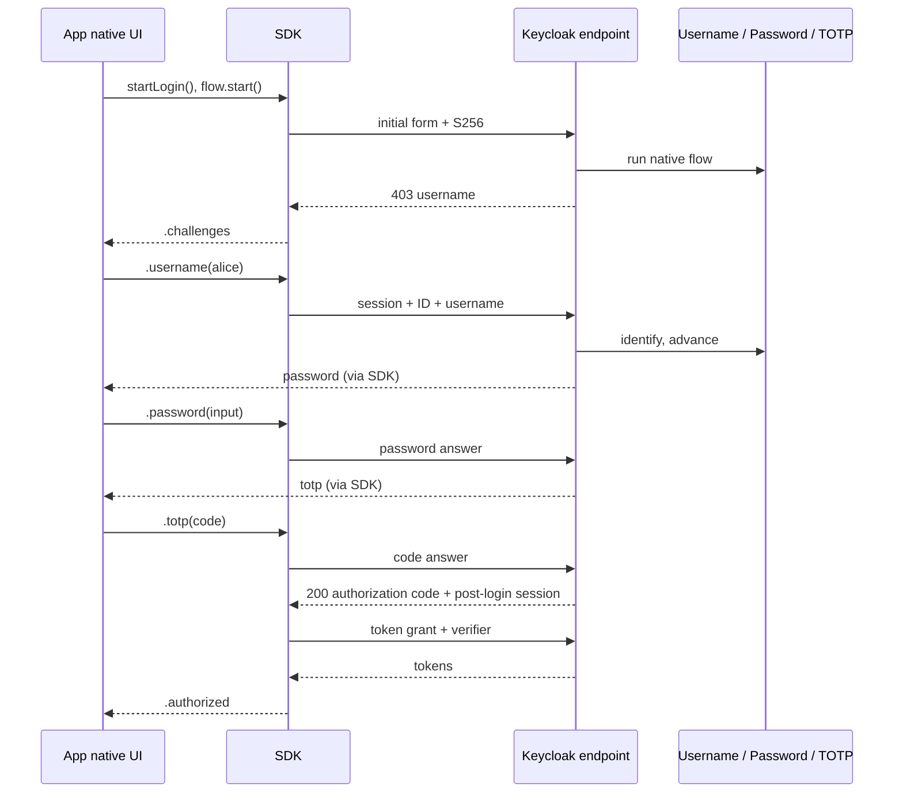
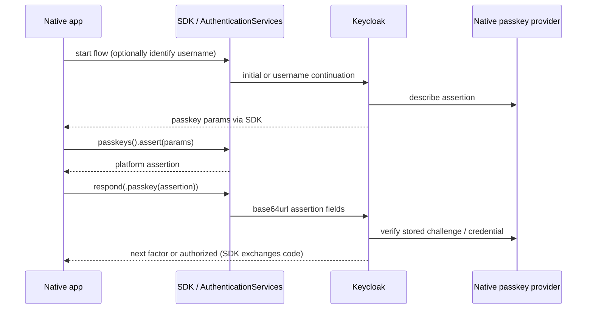
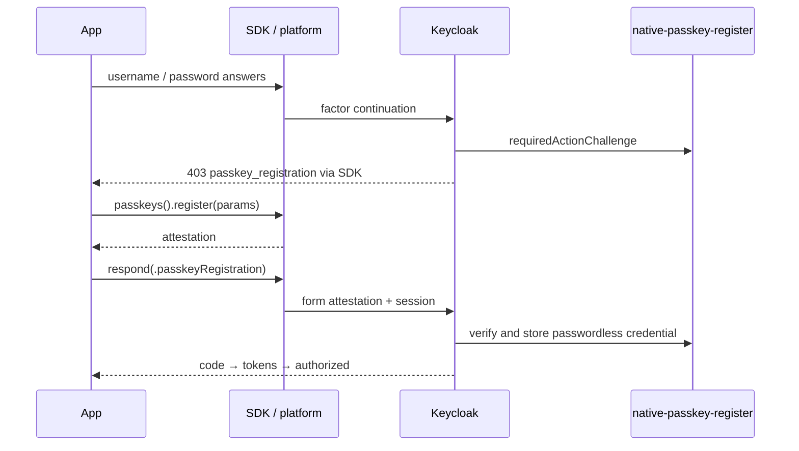
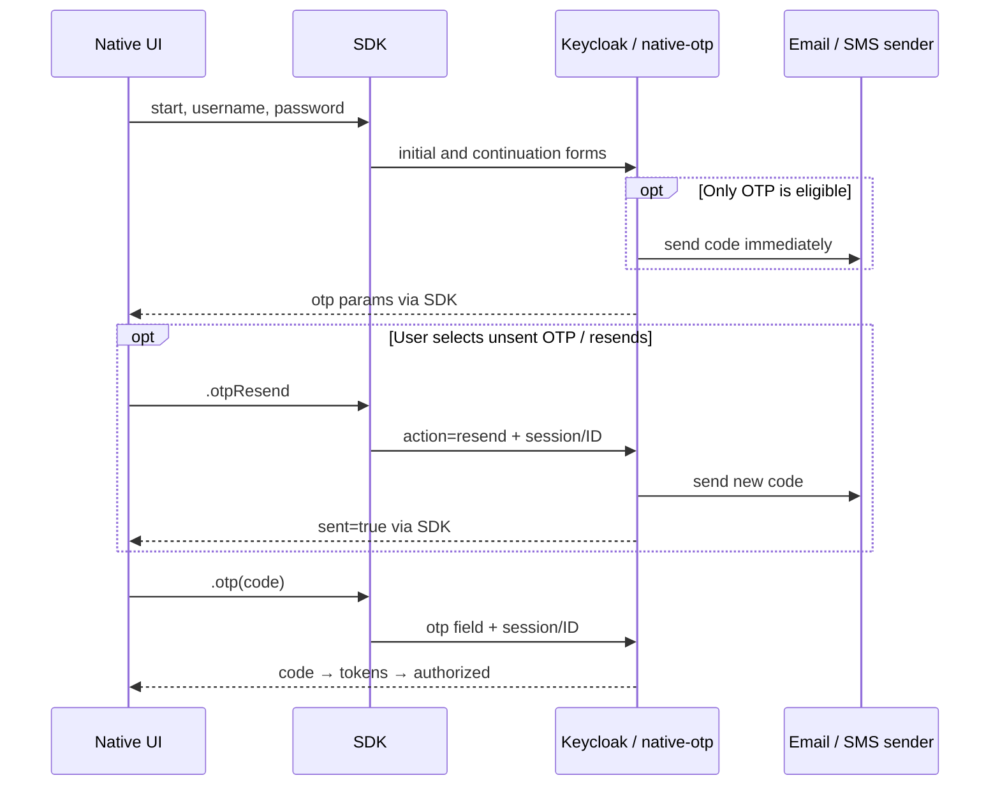
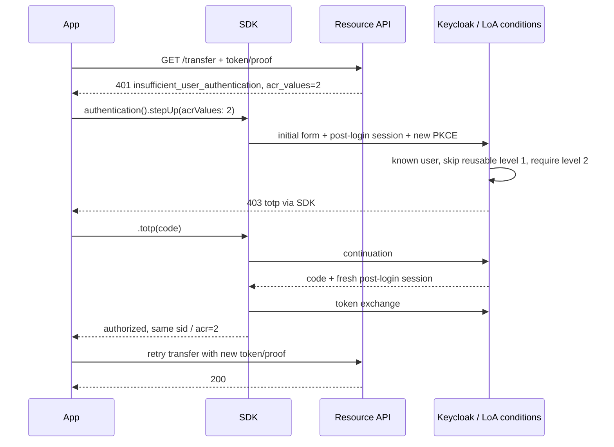
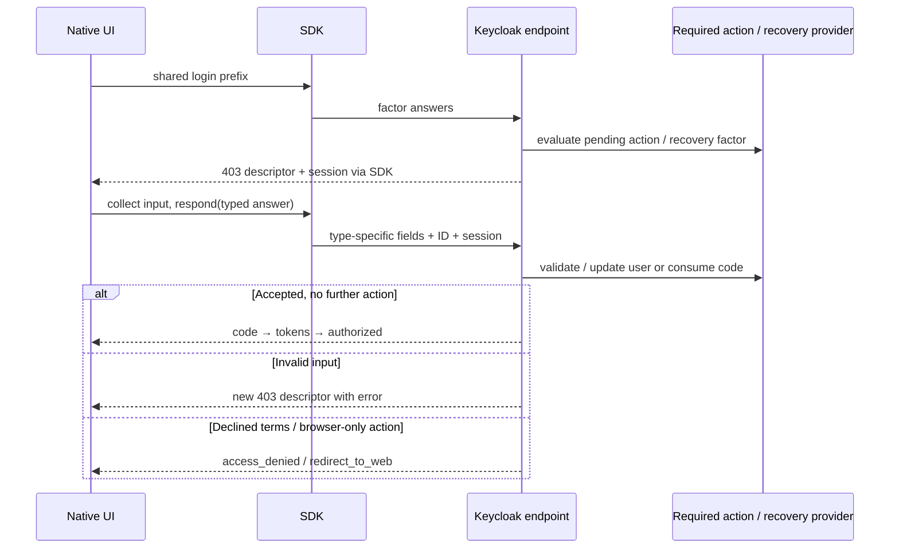
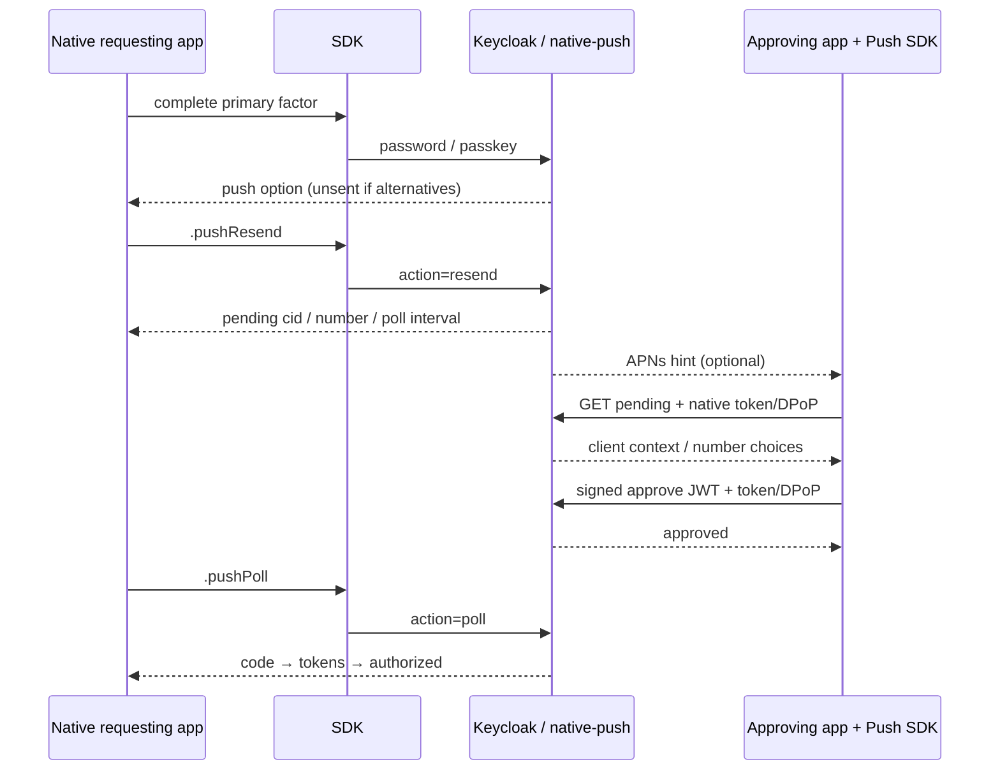
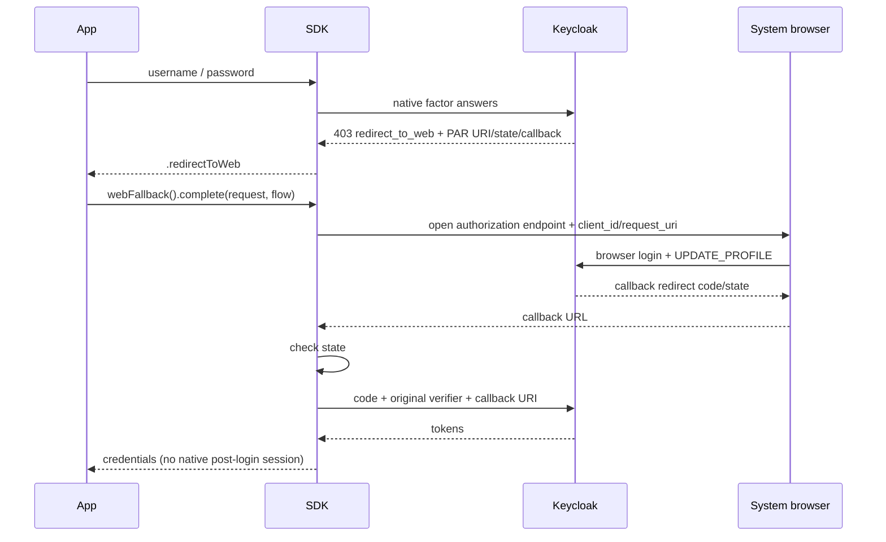

# End-to-end flow examples

[Index](README.md) · [Contract and providers](protocol-and-flows.md) · [iOS APIs](ios-integration.md) · [Android APIs](android-integration.md)

Examples below are **illustrative, derived from source and committed integration transcripts**, with secrets and opaque values replaced. They are not runnable signed WebAuthn or DPoP payloads. `<session-1>`, `<session-2>` mean successive opaque server values; always use the latest. `<execution-…>` means the actual returned descriptor ID, not a configurable constant. URLs use `https://idp.example.com/realms/demo`; the local demo uses `http://localhost:8089/realms/demo`. All challenge requests are form-encoded POSTs to `/native-auth/challenge` with JSON accept headers. Angle-bracket values require URL encoding. Optional DPoP proofs are omitted from examples; if initial request proves a key, every continuation and exchange must prove the same key.

## Concrete exported flows

These layouts are transcribed from [demo-realm.json](../keycloak-native-auth/demo/realm-export/demo-realm.json), in priority order. R = REQUIRED, A = ALTERNATIVE, C = CONDITIONAL; parentheses give priority, and brackets name subflows. These labels are execution requirements, distinct from descriptor `required`.

```text
native                                      client demo-native (realm default)
  R(10) native-username
  R(20) [native - primary factor]
    A(5) native-passkey
    A(10) native-password
  C(30) [native - second factor]
    R(10) conditional-user-configured
    A(20) native-totp
    A(25) native-push                     config: native-push - number match
    A(30) native-recovery-code

native-alternatives                         client demo-native-alt
  R(10) native-username
  R(20) [native-alternatives - factor]
    A(10) native-password
    A(20) native-totp

native-passkey-first                        client demo-native-passkey
  R(10) [native-passkey-first - identify]
    A(10) native-passkey
    A(20) [native-passkey-first - username password]
      R(10) native-username
      R(20) native-password
  C(20) [native-passkey-first - second factor]
    R(10) conditional-user-configured
    A(20) native-totp

native-step-up                              client demo-native-stepup
  R(10) native-username
  C(20) [native-step-up - level 1]
    R(10) conditional-level-of-authentication config: native-step-up - level 1 condition
    R(20) [native-step-up - primary factor]
      A(5) native-passkey
      A(10) native-password
  C(30) [native-step-up - level 2]
    R(10) conditional-level-of-authentication config: native-step-up - level 2 condition
    R(15) conditional-user-configured
    A(20) native-totp

native-otp                                  client demo-native-otp
  R(10) native-username
  R(20) native-password
  C(30) [native-otp - second factor]
    R(10) conditional-user-configured
    A(20) native-totp
    A(30) native-otp                      config: native-otp - email

native-sms                                  client demo-native-sms
  R(10) native-username
  R(20) native-password
  R(30) native-otp                        config: native-otp - sms

native-pin                                  client demo-native-pin
  R(10) native-username
  R(20) native-password
  C(30) [native-pin - second factor]
    R(10) conditional-user-configured
    R(20) native-pin                      config: native-pin - attempts
```

All subflows use `basic-flow`. Per-client selections use client attribute `native-auth.flow-alias`; the realm selects `native` by default. Config aliases and exact string-valued maps:

| Alias | Config |
| --- | --- |
| `native-step-up - level 1 condition` | `loa-condition-level=1`, `loa-max-age=36000` |
| `native-step-up - level 2 condition` | `loa-condition-level=2`, `loa-max-age=0` |
| `native-otp - email` | `channel=email`, `digits=6`, `ttl=300`, `resend-cooldown=10`, `max-attempts=3` |
| `native-otp - sms` | `channel=sms-webhook`, `digits=6`, `ttl=300`, `resend-cooldown=10`, `max-attempts=3` |
| `native-push - number match` | `userVerification=number-match`, `loginChallengeTtlSeconds=240`, `pollIntervalSeconds=3` |
| `native-pin - attempts` | `max-attempts=3` |

All native demo clients are public, standard-flow enabled, native-enabled and require S256. No passkeys or push credentials are preseeded. Conditional second factors reflect credential availability; a passkey in the primary stage does not automatically waive a later factor. To waive it, add Keycloak's stock **Condition - credential** (`conditional-credential`) as REQUIRED inside the second-factor subflow with credentials `webauthn-passwordless` and "included" off: `native-passkey` records that credential type on success, as Keycloak's own passwordless authenticator does. Selecting `webauthn` (the two-factor WebAuthn type) instead never matches a native passkey login. `CredentialConditionIT` covers both the username-first and passkey-first layouts. `native-alternatives` deliberately accepts password **or** TOTP, not both: it demonstrates choices, not two-factor login.

## Shared start, continuation and token completion

Every fresh example begins with metadata discovery (`kc.metadata()` is optional; `flow.start()` does it when needed):

```http
GET /realms/demo/native-auth/metadata
Accept: application/json
```

200 body (selected fields):

```json
{"protocol_version":"1","authorization_challenge_endpoint":"https://idp.example.com/realms/demo/native-auth/challenge","token_endpoint":"https://idp.example.com/realms/demo/protocol/openid-connect/token","authorization_endpoint":"https://idp.example.com/realms/demo/protocol/openid-connect/auth","code_exchange":{"redirect_uri_required":false},"passkey":{"rp_id":"localhost","register_options_endpoint":"https://idp.example.com/realms/demo/native-auth/passkey/register/options","register_finish_endpoint":"https://idp.example.com/realms/demo/native-auth/passkey/register/finish"}}
```

The export RP ID is `localhost`; change it and the public host together for real platform passkeys. Other advertised fields are described in the [contract](protocol-and-flows.md#discovery-and-starting).

Initial form, using a PKCE pair from the standard RFC example for illustration:

```text
client_id=demo-native&response_type=code&scope=openid%20profile&code_challenge=E9Melhoa2OwvFrEMTJguCHaoeK1t8URWbuGJSstw-cM&code_challenge_method=S256&device_name=Example%20iPhone
```

Shared terminal response after all required factors/actions:

```http
HTTP/1.1 200 OK
Content-Type: application/json
Cache-Control: no-store

{"authorization_code":"<code>","auth_session":"<post-login-session>"}
```

SDK automatically POSTs to `/protocol/openid-connect/token`:

```text
grant_type=authorization_code&client_id=demo-native&code=<code>&code_verifier=dBjftJeZ4CVP-mB92K27uhbUJU1p1r_wW1gFWFOEjXk
```

```json
{"access_token":"<access-token>","token_type":"Bearer","expires_in":300,"refresh_token":"<refresh-token>","refresh_expires_in":1800,"id_token":"<id-token>","scope":"openid email profile"}
```

The client ID in each token exchange must match the example's initial client. With token binding the result is `token_type:"DPoP"`. The SDK exposes `.authorized(credentials)` only after this exchange. The application then explicitly persists credentials and enters its signed-in navigation. Other examples below reuse this completion instead of repeating it.

## Username, password and conditional factors

Preconditions: `demo-native` / `native`, enabled existing user. `alice` has password/TOTP; `bob` has only password. Start with `kc.authentication().startLogin()` then `await flow.start()`.



1. Initial response is 403 with `auth_session:"<session-1>"`, `expires_in:1800`, descriptor `{"type":"username","id":"<execution-username>","required":true,"params":{"allow_email":true}}`. SDK `.challenges` → text field.
2. Submit `auth_session=<session-1>&challenge_type=username&challenge_id=<execution-username>&username=alice` using `.username("alice")`. Response: 403, `<session-2>`, descriptor `{"type":"password","id":"<execution-password>","required":true,"params":{"username_known":true}}`. No preseeded passkey, so password is the only primary choice.
3. Submit `auth_session=<session-2>&challenge_type=password&challenge_id=<execution-password>&password=<password-input>` using `.password(input)`. Response: 403, `<session-3>`, descriptor `{"type":"totp","id":"<execution-totp>","required":true,"params":{"digits":6,"period":30,"algorithm":"HmacSHA1","credential_labels":["Phone"],"credentials":[{"id":"<otp-credential>","label":"Phone"}]}}`. UI asks for authenticator code.
4. Submit `auth_session=<session-3>&challenge_type=totp&challenge_id=<execution-totp>&totp=<current-code>` using `.totp(input)`, optionally `credential_id=<otp-credential>`. Response is shared code/token completion. For bob, step 3 directly completes: conditional second factor is skipped.

Wrong password/TOTP returns a new 403 envelope with error on that descriptor, e.g. `"error":{"code":"invalid_credential","message":"Invalid password"},"retry":{"remaining":4}`. Use the new session/descriptor and let the user retry. Empty password returns `missing_credential` without a failure. Locked account eventually gives 403 `access_denied`. Unknown user defaults to a phantom password challenge; it never authenticates. Cancellation and session expiry follow the [common error contract](protocol-and-flows.md#errors-retries-and-cancellation).

For `demo-native-alt`, use the same start/username steps but receive `[password,totp]` (both `required:false`) for alice; either answer completes immediately. Bob receives only password. See [NativeAuthIT](../keycloak-native-auth/demo/src/test/java/io/phasetwo/keycloak/nativeauth/demo/NativeAuthIT.java) and its [happy-path transcript](../keycloak-native-auth/demo/transcripts/NativeAuthIT.happyPathUsernamePasswordTotpYieldsTokensWithoutRedirectUri.json).

## Passkey login and registration

Use the exported `native` or `native-passkey-first` layouts above. Passwordless policy is RP ID `localhost`, ES256/RS256, required UV/resident key, attestation `none` in the export. Platform ceremony additionally requires an associated HTTPS domain and matching accepted origin; see [sample passkeys](sample-app.md#real-passkeys).



1. After registration, identified alice on `demo-native` gets `[passkey,password]` after username. On `demo-native-passkey` the very first set is `[passkey,username]`; choose passkey for discoverable login or username → password for its other subflow. Initial client ID is `demo-native-passkey`; username/password fields match the shared example.
2. Illustrative assertion descriptor: `{"type":"passkey","id":"<execution-passkey>","required":false,"params":{"challenge":"<base64url-challenge>","rp_id":"idp.example.com","timeout":60000,"user_verification":"required","allow_credentials":[],"discoverable":true}}`. Identified mode instead lists enrolled `{type:"public-key",id:"<credential>",transports:[…]}` and `discoverable:false`.
3. Native UI invokes `try await kc.passkeys().assert(params)`, then `flow.respond(.passkey(assertion), to: challenge)`. Form: `auth_session=<latest>&challenge_type=passkey&challenge_id=<execution-passkey>&credential_id=<credential>&client_data_json=<base64url-client-data>&authenticator_data=<base64url-authenticator-data>&signature=<base64url-signature>&user_handle=<base64url-user-id>`. Discoverable mode resolves user from handle; identified mode can omit handle.
4. Success advances to conditional second factor (TOTP for alice in `native-passkey-first`; `native` also allows enrolled push/recovery) and shared completion. A passkey does not remove these executions. Wrong signature yields `invalid_credential` with a **new** assertion challenge; missing fields yields `missing_credential`. Platform cancellation (`passkey_cancelled`) sends no answer; choose an alternative or cancel the whole flow.

Mid-flow registration uses `dave` / `dave-password` on `demo-native` with enabled, assigned `native-passkey-register`. It is a required action, not a primary authentication factor:



1. Run common username/password prefix as dave. Response: 403, new session, one `passkey_registration` descriptor ID `native-passkey-register` with `required:true`.
2. Params: `{"challenge":"<challenge>","rp":{"id":"idp.example.com","name":"demo"},"user":{"id":"<base64url-user-id>","name":"dave","display_name":"Dave"},"pub_key_cred_params":[{"type":"public-key","alg":-7},{"type":"public-key","alg":-257}],"authenticator_selection":{"resident_key":"required","user_verification":"required","require_resident_key":true},"attestation":"none","exclude_credentials":[],"timeout":60000}` (timeout/name illustrate policy-driven values).
3. Platform registration then `.passkeyRegistration(attestation,label:"iPhone")` submits `auth_session=<latest>&challenge_type=passkey_registration&challenge_id=native-passkey-register&credential_id=<credential>&client_data_json=<data>&attestation_object=<attestation>&transports=internal&label=iPhone`.
4. Stored credential clears the action → code/token completion. Invalid attestation rechallenges with `invalid_attestation` and fresh options; the user-action timeout applies. Future dave login offers passkey. To schedule this automatically for password-only users, set `enrol-on-first-login=true` on the ALTERNATIVE `native-passkey` execution and enable the action; the export does not set that flag. [EnrolOnFirstLoginIT](../keycloak-native-auth/demo/src/test/java/io/phasetwo/keycloak/nativeauth/demo/EnrolOnFirstLoginIT.java) modifies execution configuration for its test.

Post-login registration is the same platform ceremony without a login execution:

1. Obtain fresh credentials, `kc.passkeys().registerNewPasskey(label:credentials:)`.
2. SDK `POST /native-auth/passkey/register/options`, no body, `Authorization: Bearer <access>` or DPoP token + proof → 200 creation options above plus `registration_id:"<registration>"`.
3. After platform UI, SDK `POST /native-auth/passkey/register/finish`, JSON `{"registration_id":"<registration>","credential_id":"<credential>","client_data_json":"<data>","attestation_object":"<attestation>","transports":"internal","label":"iPhone"}` → 201 `{"credential_id":"<credential>","label":"iPhone"}`. No new tokens/session are issued.
4. A stale authentication gives 403 `{"error":"insufficient_authorization","auth_session":"<post-login-session>","max_age":300,…}`. Drive `continueAfterTokenChallenge(error)` with a new PKCE pair, store authorized credentials, then retry registration; a refreshed access token alone is insufficient. Expired/reused registration IDs or failed verification require fresh options.

Evidence: [PasskeyIT](../keycloak-native-auth/demo/src/test/java/io/phasetwo/keycloak/nativeauth/demo/PasskeyIT.java) and [registration transcript](../keycloak-native-auth/demo/transcripts/PasskeyIT.registerThroughAuthenticatedEndpointsAfterPasswordTotpLogin.json). Software WebAuthn tests do not verify Apple's actual UI/device behavior.

## Email and SMS codes

Use `demo-native-otp` / `native-otp` or `demo-native-sms` / `native-sms`. Bob has an email; SMS additionally needs the webhook and allowed `phoneNumber` attribute. Compose configures SMTP to mailpit but **no SMS webhook**. `SmsOtpIT` enables unmanaged user attributes and configures its own sink; those test-only changes are not exported automatically.



1. Shared start/username/password prefix with the chosen client. Bob's email flow or required SMS step returns 403 singleton `otp`, already sent. Alice on email flow gets `[totp,otp]` with unsent OTP.
2. Example descriptor: `{"type":"otp","id":"<execution-otp>","required":false,"params":{"channel":"email","destination_masked":"a***@example.com","digits":6,"ttl":300,"sent":false}}`. SDK `.challenges` → choose code delivery screen. SMS reports `channel:"sms"` and a masked phone destination.
3. For unsent/resend, `.otpResend` → `auth_session=<latest>&challenge_type=otp&challenge_id=<execution-otp>&action=resend`. Response 403 replaces session and params with `sent:true,resend_allowed_at:<unix-time>`. Read email in mailpit or receive SMS; no code is exposed in the challenge response.
4. `.otp(input)` → `auth_session=<latest>&challenge_type=otp&challenge_id=<execution-otp>&otp=<delivered-code>` → shared completion; alternatively alice can answer TOTP and skip delivery. Wrong code → `invalid_credential`; third wrong demo attempt invalidates outstanding code (`expired_code`, `sent:false`). Wait for cooldown then resend; code TTL and overall flow timeout are independent. An early resend → `resend_too_soon` without consuming a failed attempt. Delivery failure keeps/reissues a challenge rather than producing tokens.

Evidence: [OtpIT](../keycloak-native-auth/demo/src/test/java/io/phasetwo/keycloak/nativeauth/demo/OtpIT.java), [SmsOtpIT](../keycloak-native-auth/demo/src/test/java/io/phasetwo/keycloak/nativeauth/demo/SmsOtpIT.java), and [email-choice transcript](../keycloak-native-auth/demo/transcripts/OtpIT.aliceChoosesBetweenTotpAndEmailAndTheCodeIsOnlySentOnRequest.json).

## Step-up and reauthentication

Preconditions: previously stored native credentials/post-login session for the **same client**, `demo-native-stepup` / `native-step-up`, alice has TOTP. A regular initial login runs username and level-1 password/passkey → shared completion with `acr=1`. A fresh login including `acr_values=2` also asks TOTP before completion.



1. API `GET http://localhost:8091/transfer` with headers from `kc.resourceRequestHeaders` returns 401 body `{"error":"insufficient_user_authentication","acr_values":"2",…}` below ACR 2. The app decides to step up; Core does not intercept API calls.
2. `try await kc.authentication().stepUp(acrValues:"2")`, then `start()` sends `client_id=demo-native-stepup&response_type=code&scope=openid&code_challenge=<new-S256>&code_challenge_method=S256&acr_values=2&auth_session=<post-login-session>`.
3. Server checks session/client/key, identifies user, carries previous levels and runs flow conditions. Response: 403 new in-flow session, only TOTP, `context:{username:"alice",step_up:true,acr_requested:"2",…}`. Native TOTP screen submits normal TOTP continuation.
4. Shared completion exchanges using **new** verifier, preserves user session (`sid`) and yields elevated ACR. Store replacement credentials, then explicitly retry API request. `max_age=0`/`prompt=login` can force primary-factor reauthentication; username remains known. If no level needs authentication, step-up can return code immediately. Flow without LoA conditions reasks factors and does not magically produce ACR 2.

Expired post-login value, ended user session or a different `client_id`/key → `invalid_session`: start a fresh login. Token refresh does not renew the post-login value's expiry. Evidence: [StepUpIT](../keycloak-native-auth/demo/src/test/java/io/phasetwo/keycloak/nativeauth/demo/StepUpIT.java), [step-up transcript](../keycloak-native-auth/demo/transcripts/StepUpIT.stepUpToLevel2AsksOnlyForTotpAndKeepsTheUserSession.json).

## Password update, email verification, terms and recovery codes

Use `demo-native` / `native`. On a fresh export carol has `UPDATE_PASSWORD`, grace `VERIFY_EMAIL`, hank `TERMS_AND_CONDITIONS`; their native substitutes are enabled. Ivy has TOTP plus three single-use recovery codes. These use the same prefix and terminal exchange as username/password login; each required-action response contains a **single** descriptor.



| Ordered operation after common username/password prefix | Challenge params → SDK/UI → continuation → result |
| --- | --- |
| Carol: required password update | 403 `type:update_password,id:native-update-password`, `params:{username:"carol",policy:{…}}`. Show policy hints and two secure fields. `.updatePassword(new,confirm:new)` sends `auth_session=<latest>&challenge_type=update_password&challenge_id=native-update-password&password=<new>&password_confirm=<new>`. Policy/mismatch returns 403 descriptor error `invalid_password`/`password_mismatch`; success updates credential, removes pending action, then shared completion. |
| Grace: email ownership | 403 `type:verify_email,id:native-verify-email`, `params:{email_masked:"g***@example.com",digits:6,ttl:300,sent:true,resend_allowed_at:<time>}`; a code is sent immediately. `.verifyEmail(code:input)` sends `auth_session=<latest>&challenge_type=verify_email&challenge_id=native-verify-email&code=<code>`. `.verifyEmailResend` sends `action=resend` instead of code. Success marks verified → completion. Missing/wrong/expired/cooldown errors rechallenge. |
| Hank: terms | 403 `type:terms,id:native-terms`, `params:{text:"<configured text>",url:"<configured URL>",version:"<version>"}`. Display terms and acceptance controls. `.terms(accepted:true)` sends `auth_session=<latest>&challenge_type=terms&challenge_id=native-terms&accepted=true`. Success timestamps acceptance → completion; false gives 403 `access_denied`, no code; malformed acceptance rechallenges `missing_credential`. |
| Ivy: recovery alternative after password | 403 `[totp,recovery_code]`, recovery ID `<execution-recovery>`, params `{remaining:3,warning_threshold:<policy-value>}`. Show warning/count and code field. `.recoveryCode(input)` sends `auth_session=<latest>&challenge_type=recovery_code&challenge_id=<execution-recovery>&recovery_code=<code>`. Correct unused code consumes it and completes, unless it was the last: adds browser-only `CONFIGURE_RECOVERY_AUTHN_CODES` and returns `redirect_to_web`. Wrong/used code → 403 `invalid_credential`; TOTP remains another option. |

Demo values: `carol-password`, `grace-password`, `hank-password`, `ivy-password`; seeded ivy codes `IVY1-IVY1-IVY1`, `IVY2-IVY2-IVY2`, `IVY3-IVY3-IVY3`, consumed in order by the demo tests. Required-action timeouts are 300 s, not the 1800 s factor timeout. These are operations for already authenticated users within login, not registration or forgotten-password recovery. Evidence: [RequiredActionsIT](../keycloak-native-auth/demo/src/test/java/io/phasetwo/keycloak/nativeauth/demo/RequiredActionsIT.java), [RecoveryCodeIT](../keycloak-native-auth/demo/src/test/java/io/phasetwo/keycloak/nativeauth/demo/RecoveryCodeIT.java).

## PIN codes

Use `demo-native-pin` / `native-pin` (spec/03 §4.17, §4.18; the PIN extension, spec/20). pia has the PIN `2580` seeded in the export; pete has keycloak-pin's **Configure PIN** (`phasetwo-configure-pin`) pending, which `native-configure-pin` serves in-band. Both start with the shared username/password prefix (`pia-password`, `pete-password`); each PIN response contains a **single** descriptor.

| Ordered operation after the username/password prefix | Challenge params → SDK/UI → continuation → result |
| --- | --- |
| pete: set a PIN | 403 `type:pin_setup,id:native-configure-pin,required:true`, `params:{length:4}` (Configure PIN's `length`). Show two numeric entries of that length. `.pinSetup(pin,confirm:)` sends `auth_session=<latest>&challenge_type=pin_setup&challenge_id=native-configure-pin&pin=<digits>&pin_confirm=<digits>`. An empty `pin` → `missing_credential`; `pin_confirm` differs → `pin_mismatch`; `1111`, `1234` → `weak_pin`; `12` → `invalid_format`; none counts as a failed login. Success stores the PIN, removes `phasetwo-configure-pin` from the user, then shared completion. |
| pia: PIN as second factor | 403 `type:pin,id:<execution-pin>,required:true`, `params:{length:4}` (the stored PIN's length). `.pin(digits)` sends `auth_session=<latest>&challenge_type=pin&challenge_id=<execution-pin>&pin=<digits>`. Wrong PIN → 403 descriptor `error.code:invalid_credential`, `retry:{remaining:2}` (the execution's `max-attempts` minus the PIN's failures); it is also a brute-force failure. Correct PIN → completion. |
| A third wrong PIN | The attempt that reaches `max-attempts` returns `error.code:credential_locked`, `retry:{remaining:0}`. Later logins announce the lock on the first `pin` descriptor, and every answer, even the right PIN, gets `credential_locked` again. Show that the PIN must be reset and offer cancel (`action=cancel`); do not offer another try. |
| Reset | An administrator deletes the PIN on the user's Credentials tab (the conditional sub-flow then skips it) or assigns **Configure PIN** (the next native login asks for `pin_setup`); the user can also use the realm's reset credentials flow with keycloak-pin's **Reset PIN** in the browser. A new PIN starts unlocked. |

Evidence: [PinIT](../keycloak-native-auth/demo/src/test/java/io/phasetwo/keycloak/nativeauth/demo/PinIT.java) and its recorded transcripts. `PinIT` creates and deletes its own lockout users; locking pia in the compose stack lasts until a reset (`docker compose down -v` restores the export).

## Push enrollment and approval

Use `demo-native` / `native`; device signing key = SDK DPoP key. Device API access needs a native DPoP-bound user token and local enrollment. Post-login enrollment also requires authentication within 300 s. `none` delivery permits polling without Apple infrastructure. Real `apns` needs a device token and configured server sender.



1. Enroll after ordinary native login: `try await kc.credentialsManager().store(credentials)` then `try await kc.push().enroll(deviceLabel:"iPhone")`. SDK POST `/native-auth/push/enroll/start` with access token/proof → 200 `{"enrollment_token":"<realm-signed-enrollment-JWT>","expires_in":240,"device_api_base":"https://idp.example.com/realms/demo/push-mfa","user_id":"<user-id>"}`.
2. SDK builds device JWT with enrollment ID/nonce/user, public key, credential/device IDs, `deviceType:"ios"`, label/provider and a 120-second `exp`. POST `/push-mfa/enroll/complete` JSON `{"token":"<device-signed-JWT>"}` with native token/proof → enrolled status (200/201). SDK persists `PushEnrollment`; server stores credential. `pushProviderType:"none"` skips notification delivery.
3. Next alice native login after username/password offers `[totp,push]`; push descriptor `{"type":"push","id":"<execution-push>","required":false,"params":{"sent":false,"devices":[{"label":"iPhone"}],"poll_interval":3}}`. Choose send: `auth_session=<latest>&challenge_type=push&challenge_id=<execution-push>&action=resend` via `.pushResend`.
4. 403 new session/params: `sent:true,cid:"<push-id>",status:"pending",expires_at:<time>,poll_interval:3,user_verification:{type:"number_match",number:"42"},resend_allowed_at:<time>`. Show **42** on requester, then `.pushPoll` submits same common fields with `action=poll` every 3 s. Pending returns another 403, replacing continuation state each time.
5. Approving device `kc.push().pendingApprovals()` performs GET `/push-mfa/login/pending?userId=<user-id>` with DPoP access token/proof → `{"challenges":[{"cid":"<push-id>",…}]}`. Native screen displays client context and number choices. `.respond(to:approval,.approve(userVerification:"42"))` POSTs `/push-mfa/login/challenges/<push-id>/respond` JSON `{"token":"<device-JWT: cid,credId,deviceId,action=approve,userVerification=42,exp>"}` → 200 `{"status":"approved"}`. `.deny` similarly returns denied; mismatched number → 403; resolved meanwhile → 409, refresh pending list.
6. Requester's next poll consumes approval and advances to shared completion. Denial yields descriptor `error.code:"denied"`, counts a failure and allows alternatives/resend; expiry yields `expired`, resend needed. Resend before 10 s → `resend_too_soon`. Canceling native session does not immediately remove the push-store challenge; it expires independently.

For **judy** (`judy-password`), upstream `push-mfa-register` is pending on first login. Instead of step 1's authenticated endpoint, the password response is 403 single `push_enrollment` descriptor, ID `native-push-enroll`, with the same enrollment params. `prepareEnrollment(for:deviceLabel:)` creates the signed answer; submit `auth_session=<latest>&challenge_type=push_enrollment&challenge_id=native-push-enroll&token=<device-JWT>`. On acceptance, commit local prepared enrollment and complete code/token exchange. No pre-login access token is needed for this in-flow operation. A fresh single push factor on judy's next login sends automatically. Invalid input rechallenges using the pending enrollment; expiry replaces it. Rebuild prepared data from the returned params.

Browser approval uses a separate exported browser flow, not `/native-auth/challenge`: `browser-push`: A(10) `auth-cookie`, A(20) `identity-provider-redirector`, A(30) `[browser-push - forms]`; forms: R(10) `auth-username-password-form`, C(20) `[browser-push - push]`; push: R(10) `conditional-user-configured`, R(20) `push-mfa-authenticator`. The browser waits on upstream UI while the phone uses step 5's same pending/respond API; a cookie SSO path may skip form login. This is intentionally browser interaction for the **requester**, with a native approving phone. [PushMfaIT](../keycloak-native-auth/demo/src/test/java/io/phasetwo/keycloak/nativeauth/demo/PushMfaIT.java) covers both requesters and maintenance; [push transcript](../keycloak-native-auth/demo/transcripts/PushMfaIT.scenarioB_aNativeLoginOffersPushWithNumberMatch.json).

## Unsupported required action and browser fallback

Preconditions: `demo-native` / `native`, frank / `frank-password`, pending `UPDATE_PROFILE`, configured registered callback `demoapp://auth/callback`, initial S256 and PAR feature. Built-in browser flow above completes the unsupported profile action.



1. Common prefix as frank, then password → 403 `{"error":"redirect_to_web","error_description":"Complete the login in a browser: required_action:UPDATE_PROFILE","request_uri":"urn:ietf:params:oauth:request_uri:<opaque>","expires_in":60,"redirect_uri":"demoapp://auth/callback","state":"<server-state>","reason":"required_action:UPDATE_PROFILE"}`. No native continuation remains.
2. SDK `.redirectToWeb(request)` → app offers Open browser, calls `kc.webFallback().complete(request,flow:flow)`. Browser GET `/protocol/openid-connect/auth?client_id=demo-native&request_uri=<encoded-request-uri>` returns normal Keycloak HTML/forms/cookies; it does not transfer native factor success into the browser session. User completes browser authentication/profile action.
3. Browser redirect `demoapp://auth/callback?code=<browser-code>&state=<server-state>` → SDK validates state → POST token form `grant_type=authorization_code&client_id=demo-native&code=<browser-code>&code_verifier=<original-verifier>&redirect_uri=demoapp%3A%2F%2Fauth%2Fcallback` → standard tokens. Persist result explicitly. No native post-login `auth_session` is minted by this browser exchange.
4. Expired/used PAR URI or closed browser requires a new login. `web_fallback_cancelled` leaves no native session to resume. Without initial PKCE/PAR/callback the native server instead returns terminal `access_denied`. HTML authenticator accidentally placed in native flow gives `server_error`, not this fallback. [RedirectToWebIT](../keycloak-native-auth/demo/src/test/java/io/phasetwo/keycloak/nativeauth/demo/RedirectToWebIT.java) drives the actual browser forms; UI S7 remains a manual system-browser scenario.

## Refresh, logout, restoration and cancellation

These are shared lifecycle operations, not additional Keycloak authentication-flow layouts:

1. App stores credentials explicitly after authorized. On relaunch `credentialsManager().stored()` reads local state (possibly expired); `credentials()` refreshes when within its 30-second leeway. SDK POST token form `grant_type=refresh_token&client_id=demo-native&refresh_token=<refresh>` plus current key proof → token JSON; manager stores replacements and keeps post-login session value. Concurrent manager refreshes share a task. Direct `tokens().refresh` does not persist its result.
2. Refused refresh `400 {"error":"invalid_grant",…}` becomes `reauthentication_required`; manager clears credentials. A hypothetical refresh `insufficient_authorization` with session is supported by SDK, but this server adds no token-endpoint hook emitting it.
3. `credentialsManager().logout()` POSTs logout form `client_id=demo-native&refresh_token=<refresh>` (SDK sends no DPoP here), then clears local credentials even on network failure. It does not remove passkeys, push credentials/enrollment, DPoP key or browser cookies. Direct `tokens().revoke(token:)` POSTs revoke form with `token_type_hint=refresh_token` by default and does not clear local state.
4. `await flow.cancel()` while awaiting input sends `auth_session=<latest>&action=cancel` → 400 `{"error":"invalid_session","error_description":"auth_session cancelled"}`. SDK finishes locally even if request fails; next start needs a newly created flow. No in-progress restoration API persists PKCE and challenges across process restarts.

Evidence: [CredentialsAndTokensTests](../ios/KeycloakNative/Tests/KeycloakNativeCoreTests/CredentialsAndTokensTests.swift), [lifecycle transcript](../keycloak-native-auth/demo/transcripts/NativeAuthIT.tokensCanBeRefreshedLoggedOutAndRevoked.json), and [cancel transcript](../keycloak-native-auth/demo/transcripts/NativeAuthIT.cancelledAuthSessionCannotBeReused.json).
